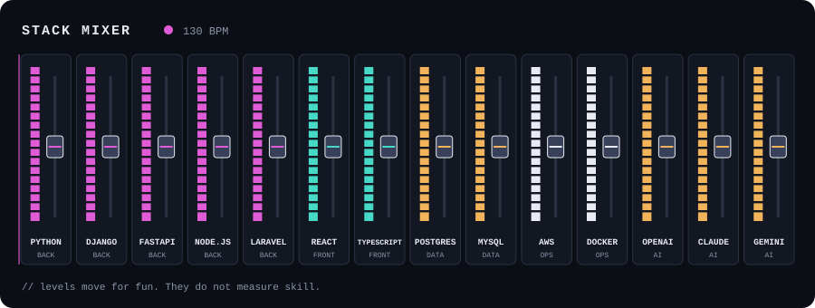

  <a href="https://jpcaicedok.github.io/jpcaicedok/">Portfolio</a> · <a href="https://www.linkedin.com/in/juanpablocaicedo">LinkedIn</a> · <a href="#english">English</a> · <a href="#español">Español</a> · <a href="#stack">Stack</a> · <a href="#career--trayectoria">Career</a>

## English

I'm a Full Stack Developer with 5+ years in software and a strong backend foundation. I build scalable systems and AI applications using OpenAI, Claude and Gemini.

**Looking for:** Full Stack Developer or Backend Developer roles, in Colombia or remote internationally. English level: B1, still studying.

### Case studies

<b>AI chatbot: from Node.js/Kotlin to Python</b>

- Took ownership of the project and drove architecture improvements.
- Migrated backend services to Python with Django, improving maintainability and performance.
- Improved resilience, reduced latency in critical microservices and optimized PostgreSQL for heavy workloads.
- Expanded OpenAI API usage: score evaluation, chunk selection, Agents vs Assistants decision and debugging tools.

<b>PLANselect: swapping the recommendation engine with clients on board</b>

- Replaced a third-party engine with our own in Python, using a per-employer V1/V2 switch to move clients gradually and without service interruptions.
- Redesigned the employee flow in React and TypeScript: mobile-ready, in English and Spanish.
- Implemented WCAG 2.2 AA accessibility and fixed the issues from a full audit.
- Integrated AI: executive summaries and plan autofill from PDFs using an LLM.

<b>AI QA bot (internal tool, not yet in use)</b>

- Designed and built the full system: Claude agent with Playwright, FastAPI with PostgreSQL, Google SSO and a React dashboard.
- Reads Jira tickets and returns a verdict per acceptance criterion, with screenshots, video and logs.
- When it solves a ticket, it records a fixed script that can rerun without paying for AI again.
- On complex tickets: ~40% lower cost, ~35% fewer steps and almost half the time.

## Español

Soy Full Stack Developer con más de 5 años en software y una sólida base backend. Construyo sistemas escalables y aplicaciones con IA usando OpenAI, Claude y Gemini.

**Qué busco:** cargos de Full Stack Developer o Backend Developer, en Colombia o en remoto internacional. Inglés B1, en formación.

### Casos de estudio

<b>Chatbot con IA: de Node.js/Kotlin a Python</b>

- Asumí la propiedad del proyecto e impulsé mejoras de arquitectura.
- Migré servicios backend a Python con Django, mejorando la mantenibilidad y el rendimiento.
- Mejoré la resiliencia, reduje la latencia en microservicios críticos y optimicé PostgreSQL para cargas intensivas.
- Amplié el uso de la API de OpenAI: evaluación de puntajes, selección de chunks, decisión Agents vs Assistants y herramientas de depuración.

<b>PLANselect: cambiar el motor de recomendaciones con los clientes a bordo</b>

- Reemplacé un motor externo por uno propio en Python, con un switch V1/V2 por empleador para migrar clientes de forma gradual y sin cortes de servicio.
- Rediseñé el flujo del empleado en React y TypeScript: adaptado a móvil, en inglés y español.
- Implementé accesibilidad WCAG 2.2 AA y corregí una auditoría completa.
- Integré IA: resúmenes ejecutivos y autocompletado de planes desde PDF con LLM.

<b>Bot de QA con IA (herramienta interna, aún no en uso)</b>

- Diseñé y construí el sistema completo: agente con Claude y Playwright, FastAPI con PostgreSQL, Google SSO y panel en React.
- Lee tickets de Jira y entrega un veredicto por criterio de aceptación, con capturas, video y logs.
- Cuando resuelve un ticket, graba un script fijo que se repite sin volver a pagar IA.
- En tickets complejos: costo ~40 % menor, ~35 % menos pasos y casi la mitad del tiempo.

## Stack

- **Backend:** Python (Django, FastAPI), PHP (Laravel), Node.js, Kotlin, Java (Spring Boot)
- **Frontend:** React, TypeScript, JavaScript, Redux Toolkit, Inertia.js, Ant Design
- **AI / IA:** OpenAI API, Claude API, Gemini, prompt engineering, embeddings
- **Data / Datos:** PostgreSQL, MySQL, SQL Server
- **DevOps:** Docker, AWS (Elastic Beanstalk, S3, WAF), Git, Bitbucket Pipelines, Playwright

## Career / Trayectoria

| Period / Periodo | Role / Cargo | Company / Empresa |
| --- | --- | --- |
| 09/2025 – Present / Actual | Full Stack Developer | Flimp |
| 02/2025 – 08/2025 | Backend Developer | Globa |
| 08/2024 – 02/2025 | Dynamics 365 Developer / Desarrollador Dynamics 365 | SoftMas |
| 09/2023 – 07/2024 | AS400 Developer / Desarrollador AS400 | Tata Consultancy Services |
| 02/2021 – 08/2023 | Backend Developer / Desarrollador Backend | Tata Consultancy Services |
| 06/2020 – 01/2021 | Freelancer, software development / desarrollo de software | KopTup |

## AI QA bot / Bot de QA con IA

